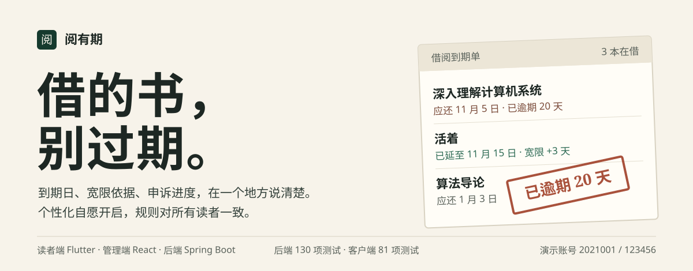
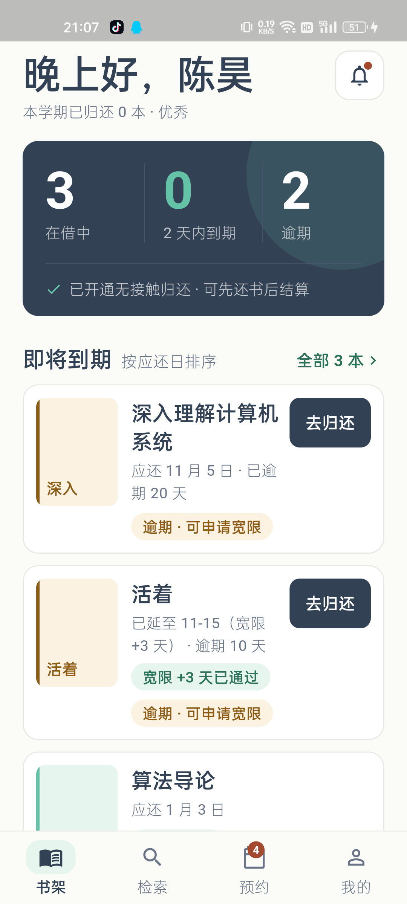
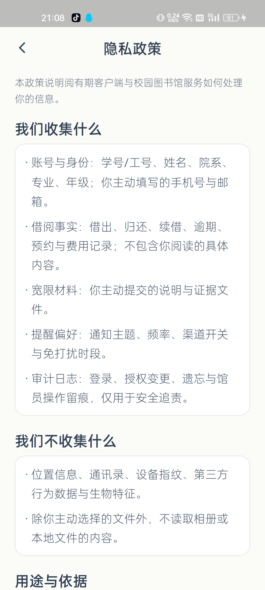
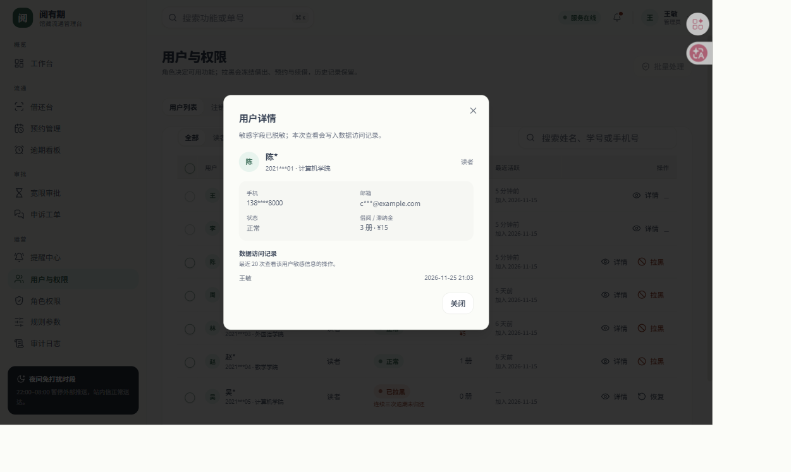
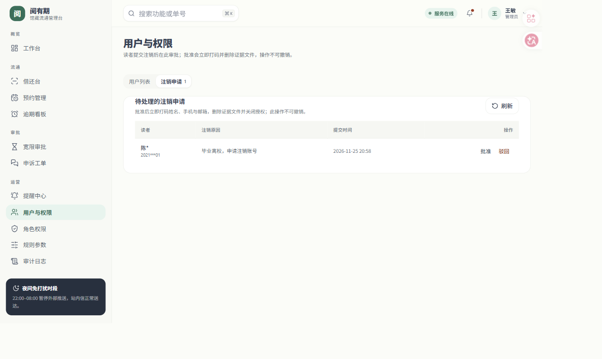

<div align="center">



**高校图书馆的「借阅到期与归还」小管家。**
到期日说清楚，宽限有依据，申诉有门；个性化自愿开启，规则对所有读者一致。

读者端 Flutter · 管理端 React · 后端 Spring Boot · 同一套契约

</div>

---

## 它解决什么

逾期不是罚款问题，是信息和尊严问题。

| 谁 | 现在的难处 | 阅有期怎么接 |
|---|---|---|
| 读者 | 不知道还剩几天，宽限凭什么批，申诉往哪递 | 到期日一眼可见；宽限按场景给依据；申诉两小时内有人接 |
| 馆员 | 名单靠导出，催还靠群发，裁量没依据 | 工作台按 SLA 排队；宽限给 3/6/9 天要写核对依据；每次裁决留 traceId |
| 图书馆 | 考试周、毕业季一刀切 | 场景只认「校历 ∩ 读者自声明」，不看历史画像 |

## 三条机制

**宽限**：申请时声明场景（毕业 / 考试 / 论文 / 合理事由），系统按「场景基准 × 信用系数 × 预约队列系数」给出建议天数，单次封顶 14 天；馆员 2 小时内裁决，超时自动补 3 天并写入到期日。

**提醒**：6 个主题 × 频率 × 渠道；22:00–08:00 免打扰顺延次日；P0（到期当天、预约到书）站内信不可关；渠道只承诺站内信与邮件，短信接口留位、调用返回 422，没开通就不写在界面上。

**申诉**：对任意判定可发起，2 小时内受理；通过、驳回都写结论；超时兜底补偿；全链路可追 traceId。

## 隐私与个性化

- **默认最小授权**：只采集借还所需字段；位置、通讯录、相册、设备指纹、第三方行为数据都不碰。
- **个性化单独开关**：「借阅场景授权」「本地缓存授权」默认关闭；关闭不参与场景宽限、不写本地缓存，借书还书照常。
- **可撤回、可遗忘**：申请遗忘后姓名/手机/邮箱/院系立即打码为「已注销读者-尾号」，借阅事实保留；同时清理宽限快照与证据文件。
- **可注销**：读者提交注销申请，馆员审批后打码并删除证据文件，借阅、逾期与费用记录按制度保留。
- **可追责**：审计日志保留 90 天；管理员每次查看读者详情都会写一条「数据访问记录」——谁看了、什么时候、为什么。

## 界面

| 读者端 · 书架 | 读者端 · 隐私与提醒 |
|---|---|
|  |  |

| 管理端 · 阅读详情写入数据访问记录 | 管理端 · 注销申请审批 |
|---|---|
|  |  |

> 截图来自演示账号 `2021001` 的真实记录，不是设计稿。

## 线上演示（2026-11-26）

| 项 | 地址 / 账号 |
|---|---|
| 管理端 | <http://8.163.136.80:8124> · `admin`（密码见部署密钥文件，不在仓库里） |
| 读者端 | Android APK，`2021001 / 123456`（陈昊，3 在借 / 2 逾期） |
| 健康检查 | <http://8.163.136.80:8124/api/v1/system/health> |
| 主机面板 | 1Panel · <http://8.163.136.80:18888/readdue>（仅限固定出口 IP） |

- 阿里云 ECS（2C / 1.7G / 40G）+ Docker Compose 五件套；镜像本地构建后 `save → load`，主机不构建。
- 只发布 `8124`（前端 nginx），后端 8125 仅容器网络；3306 / 6379 / 3389 不对公网开放。
- 初始管理员由 `ProdAdminBootstrap` 在 prod profile 首次启动时创建；生产库由演示库整库导入。
- **演示环境是 HTTP**（无域名/证书）；正式上线第一步是域名 + TLS，并删掉客户端的明文白名单。
- 分支：`dev` 开发 → `main` 验收 → `prod` 发布，三者同步后再部署。

## 快速开始

### Docker（推荐，一条命令起五件套）

```bash
cp deploy/.env.example deploy/.env
# 编辑 deploy/.env：替换 DB/Redis/RabbitMQ 口令，并设置 ≥32 字节随机 APP_JWT_SECRET
docker compose --env-file deploy/.env -f deploy/docker-compose.yml up -d --build
# 管理端 http://localhost:8080   后端 http://localhost:8125/api
```

### 本地开发

```powershell
# 后端（8125，context-path /api；JDK 21）
cd backend; mvn spring-boot:run

# 管理端（5173，代理 /api → 8125）
cd frontend; pnpm install; pnpm dev

# 读者端（模拟器用 10.0.2.2；真机换宿主机局域网 IP 或 adb reverse）
cd client; flutter run --dart-define=API_BASE_URL=http://10.0.2.2:8125/api
```

演示账号：管理员 `ADMIN001/123456`、馆员 `LIB001/123456`、读者 `2021001/123456`。
依赖：MySQL 8+（库 `readdue`）、Redis 7、RabbitMQ 3.13；本地连接串见 `backend/src/main/resources/application-local.yml`。

## 验证

```powershell
cd backend;  mvn test                      # 142 tests：141 passed，1 skipped（SMTP 未配置）
cd frontend; pnpm typecheck; pnpm build    # 13 业务页 / 14 路由
cd client;   flutter analyze; flutter test # 81 tests，analyze 0 issues
```

数据库由 Flyway 管理到 **V20**（35 张表）；新增表/列必须配迁移，不改历史脚本。

## 架构

```
backend/    Spring Boot 3.5 + MyBatis-Plus + Flyway；包根 com.zian.backend
frontend/   管理端 React 18 + Vite + TanStack Query + Radix（pnpm）
client/     读者端 Flutter 3.24（Riverpod / go_router / dio / freezed）
```

9 个业务上下文：`iam` `catalog` `borrow` `reservation` `grace` `notify` `appeal` `rule` `audit`，外加 `reporting`、`shared`、`bootstrap`。
依赖方向 `interfaces → application → domain ← infrastructure`；归还时 `BorrowOrder` + `BookCopy` 单事务强一致，其余跨上下文走 outbox。
接口契约以 [`后端的交互接口文档.md`](后端的交互接口文档.md) 为准。

## 进度与限制

- 分支 `feat/m3-progress-sync` 领先 `main` 88 个提交，尚未合并；任务与证据见 [`todolist.md`](todolist.md)。
- 提醒的 DAILY/WEEKLY 聚合（同夜摘要）尚未实现：偏好与快照已落库，聚合留待下一期。
- 短信、微信渠道为有意占位（返回 422），当前只承诺站内信与邮件。
- 读者端为 debug APK（约 110MB），未上架应用商店；本地 HTTP 演示，生产需反代与 TLS。

## 文档

- 需求与规则：Obsidian `Projects/阅有期/`（PRD、技术架构、验收清单）
- 接口契约：[`后端的交互接口文档.md`](后端的交互接口文档.md)
- 部署说明：[`deploy/README.md`](deploy/README.md)
- 任务与证据：[`todolist.md`](todolist.md)

